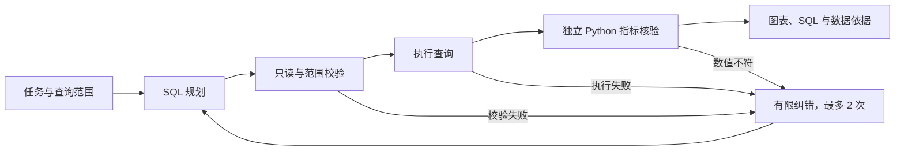
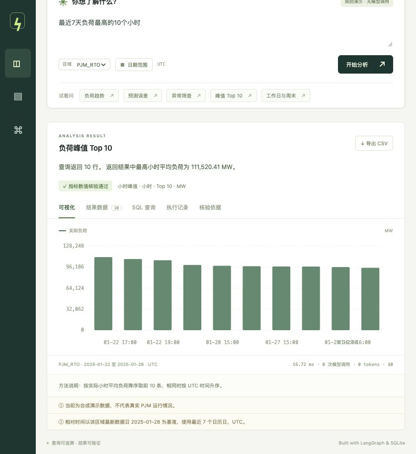

# Gridnote · Energy Data Analysis Agent

Evidence-backed energy analysis with read-only SQL, independent metric checks, and reproducible evaluations.

本地运行的能源数据分析助手：结构化任务 → SQL → 只读校验 → 执行 → 独立指标数值核验 → 有限纠错 → 图表与依据。当前版本 v0.2。

当前版本开箱即用，使用 **明确标注的合成演示数据**。可导入自己的小时负荷 CSV，也可配置 OpenAI 让模型生成 SQL。当前仓库没有连接已有的 PJM 数据管道，也未验证真实模型调用。

## 项目贡献与验证摘要

- 基于 LangGraph 实现规划、SQL 校验、执行、独立数值核验与有限重试，提供可追溯的图表、SQL 和数据来源。
- 补充领域检查，发现 SQL 可执行但聚合、单位、NULL 分母或 Top-K 错误的结果。
- 实现 CSV 校验及原子导入、只读与范围约束、超时预算、类型化拒答和错误结果清理。
- 在 3 个区域、28 天的 **2,016 条合成小时记录**上建立 **26 个评测用例**，规则模式下全部通过；本地 **101 项自动化测试**通过。
- 在 **4 类主动注入的语义 SQL 故障**中验证 **4/4 检测与反馈恢复**。该诊断不代表真实 LLM 自我纠错能力；三组自然规则用例均为 26/26。

[完整评测方法](docs/evaluation.md) · [原始逐题报告](reports/evaluation.json) · [图表源数值](docs/figures/chart-values.json)



独立数值核验覆盖已定义的分析任务；超出覆盖范围的模型查询会单独标注。达到纠错上限后停止展示不可信结果。



## 快速启动

需要 Python 3.11+ 和 [uv](https://docs.astral.sh/uv/)。

```bash
uv sync --frozen
uv run energy-agent serve --port 8765
```

打开 [本地应用](http://127.0.0.1:8765)。第一次启动自动生成 `data/energy.sqlite`；已有数据库不会被启动过程覆盖。默认只监听本机。

如果依赖缓存目录不可写，可在命令前设置 `UV_CACHE_DIR="$PWD/.uv-cache"`。如果端口已占用，使用另一个 `--port`。

可直接用命令行查询和检查数据：

```bash
uv run energy-agent ask '最近7天的负荷趋势' --region PJM_RTO
uv run energy-agent ask '每日预测误差' --region DOM --start 2025-01-20 --end 2025-01-25
uv run energy-agent ask '最近7天负荷最高的10个小时' --region PJM_RTO
uv run energy-agent ask '工作日与周末负荷比较' --region DOM
uv run energy-agent ask '2025-01-01 到 2025-01-28 按周的负荷趋势' --region AECO
uv run energy-agent inspect
```

日期为 UTC，首尾日均包含。`最近7天` 以所选区域的**最新数据日**为基准，不是电脑当天。日期不提供时默认最后 7 个日历日；数据不足 7 天则取已有范围。显式请求越界会报错，不自动扩大或缩短范围。问题中的区域或日期与筛选器冲突时会报错。

## 已实现

| 能力 | 行为 |
| --- | --- |
| 分析流程 | LangGraph 显式节点、执行记录、预编译、最多 2 次查询纠错 |
| 结构化任务 | Top-K 1–100、小时/日/周/整体统计、工作日与周末分组及过滤、记录数 |
| 领域核验 | Python 独立重算已支持任务，检查聚合、单位、分母、排序、Top-K；不通过则重写或停止展示 |
| 历史异常工具 | 仅过去 28 天同小时同日类型数据，中位数/MAD，历史不足单列 |
| 可核验结果 | 实际 SQL、返回行、来源、UTC 范围、方法、截断提示、CSV 导出 |
| 数据质量 | 重复键拒绝、空预测保留、缺失小时统计、数值与整点校验、失败导入保留原库 |
| 查询约束 | AST 校验、只读连接、SQLite authorizer、所有源表引用强制套用区域与时间范围 |
| 资源约束 | 请求最多 366 天、最多展示 500 行；模型 SQL 2 秒 / 200 万 VM 指令预算、禁止递归 CTE |
| 评测 | 26 个合成用例、三组对照、类型化拒答、独立参考答案；另有 4 类显式语义故障注入诊断 |
| 模型接口 | OpenAI Responses API 的结构化计划；记录调用数、token 数和可选费用估计 |

## 演示模式与真实模型

默认 `ENERGY_PLANNER=demo` 使用规则提取任务参数并编译模板，**不调用语言模型**。支持的结构化任务会接受独立数值核验；无法识别的统计请求在规则模式下明确拒绝。配置模型后可生成开放式 SQL，但未匹配的任务会标注“语义未覆盖”，不会伪装成已验证。该解析器仍是有限规则，不是通用自然语言理解。

启用真实 SQL 生成：

```bash
cp .env.example .env
# 在本机编辑 .env，填写以下变量：
# ENERGY_PLANNER=openai
# OPENAI_API_KEY=你的密钥
# OPENAI_MODEL=你有权限调用且支持结构化输出的模型
uv run energy-agent serve --port 8765
```

异常任务调用固定的本地历史工具，即使配置 OpenAI 也不调用模型；其他任务按配置生成 SQL。示例配置中的模型名是可修改的配置值，不保证你的账号有调用权限。重启服务后生效。问题、数据库字段说明和所选查询范围会发送给 OpenAI；原始数据行与查询结果不会发送，摘要由本地代码根据结果生成。首页预览始终使用固定查询，不会触发模型调用。`.env` 已被 Git 忽略。

模型 API 错误会明确返回，不会自动伪装成规则模式成功。查询生成最多 3 次，每次请求的 SDK 最多进行 1 次网络重试。费用仅在配置 `OPENAI_INPUT_USD_PER_MILLION` 和 `OPENAI_OUTPUT_USD_PER_MILLION` 后估算；未配置显示未知。估算不区分缓存折扣或其他计费项目，以服务商账单为准。

## 导入真实数据

CSV 必需字段为 `timestamp_utc,region,load_mw`；`forecast_mw` 可选。示例文件见 [data/example_load.csv](data/example_load.csv)。

```csv
timestamp_utc,region,load_mw,forecast_mw
2025-01-01T00:00:00Z,MY_REGION,1000,1030
2025-01-01T01:00:00Z,MY_REGION,980,
```

也接受字段别名 `datetime_beginning_utc → timestamp_utc`、`load_area → region`、`mw → load_mw`。无时区的时间按 UTC 解释，不接受本地时区的含混时间；有偏移量的时间统一换算为 UTC。每行须为整点 1 小时平均负荷，不接受未经聚合的亚小时记录。预测仍是每小时一个可选值，尚未建模预测发布时间、预测提前量及多个版本；不能据此声称完成真实预测回测。

```bash
# 默认保护已有数据库；确认要用 CSV 替换后，加 --replace。
uv run energy-agent import-csv /absolute/path/load.csv --source 'PJM 导出，文件日期及处理说明' --replace

# 或写入另一个数据库，保留当前数据：
ENERGY_DB_PATH=data/my_load.sqlite uv run energy-agent import-csv /absolute/path/load.csv --source '来源说明'
ENERGY_DB_PATH=data/my_load.sqlite uv run energy-agent serve --port 8766
```

导入先在临时数据库校验全部记录，再原子替换目标文件。重复的时间戳＋区域、非有限/负值、缺失必需字段、非整点时间、空文件都会导致失败。`forecast_mw` 留空表示未知，不能用零代替。成功导入后刷新网页。来源说明由导入者提供，应用不自动验证其真实性。

首版每次查询一个区域；RTO 总负荷与组成区域不能相加。应用不包含 PJM API 密钥、在线抓取、预测模型训练、价格数据或生产级权限管理。

## 测试与评测

```bash
uv run pytest -q
uv run ruff check energy_agent tests
uv run energy-agent evaluate --planner demo
# 已配置密钥时可主动运行真实模型评测（会产生 API 费用）：
uv run energy-agent evaluate --planner openai --output reports/openai-evaluation.json
```

评测在临时的合成数据库上运行，**不读取或改写业务导入数据**。26 题覆盖任务参数、周与日类型、缺失小时、空预测、零实际值、异常冷启动及类型化拒答。三组共用相同规划器、任务参数、安全约束及异常工具：

- `baseline`：单次生成，不预编译和重试。
- `agent`：预编译与 SQL 执行错误纠正。
- `domain`（默认）：在 `agent` 上增加独立 Python 数值核验，能触发语义纠错。

命令行可使用 `energy-agent ask '问题' --mode baseline|agent|domain`。自然规则用例三组均为 26/26，不能据此声称模型提升。报告另列 4 类**主动注入**的可执行错误 SQL：负荷误求和、电量误求平均、错误 Top-K、空预测补零。注入规划器仅在收到具体语义反馈后返回正确 SQL，用于验证反馈链路；不能代表真实 LLM 的自我纠错能力。该诊断中领域流程恢复 4/4，另外两组 0/4。详见 [docs/evaluation.md](docs/evaluation.md)。

`outcome` 区分 success、empty、insufficient_data、refused、rejected、failed；`error_code` 区分缺少数据、策略拒绝、输入范围、模型/配置/查询/语义失败。评测拒答必须匹配预期类型，API 报错不能计为正确拒答。输出另含可回答题正确率、类型化拒答正确率、系统失败数、P50/P95 延迟、tokens 和可选费用。

模型接口使用 HTTP Mock 验证真实 SDK 的请求格式、结构化解析、token 统计和错误脱敏；这不等于真实 API 联调。查询纠错测试通过注入实际不存在的列触发 SQLite 错误，不伪造模型评测成绩。

本次本地验证：101 项测试全部通过，Ruff 检查与 JavaScript 语法检查通过，源码包及 wheel 构建成功。浏览器已验证趋势、预测误差、异常筛查、SQL 展示和数据来源面板。GitHub Actions 配置已提供；本地检查通过，远程结果以 Actions 实际运行记录为准。

## 代码结构

```text
energy_agent/
  data.py          合成样本、CSV 校验、数据覆盖统计
  scope.py         区域、日期与冲突校验
  tasks.py         有限任务参数与指标定义的 SQL 编译
  metrics.py       独立 Python 指标核验与请求窗口覆盖统计
  anomaly.py       不含当前点或未来点的历史异常工具
  errors.py        机器可读的错误与拒答分类
  planner.py       规则模板 / OpenAI 结构化 SQL 计划
  sql.py           AST 范围约束、只读执行与资源预算
  agent.py         LangGraph 工作流、纠错、结果摘要
  api.py           FastAPI 与本地静态界面
  evaluation.py    Python 参考答案与基线比较
  static/          无前端构建步骤的响应式界面
tests/             查询、数据、工作流、API 与模型契约测试
```

## 开源参考与本项目实现

工作流设计参考 [LangGraph 官方 SQL Agent 教程](https://docs.langchain.com/oss/python/langgraph/sql-agent)，模型接口参考 [OpenAI Structured Outputs](https://developers.openai.com/api/docs/guides/structured-outputs)。本仓库为独立实现，没有复制完整教程仓库；依赖库保留各自许可证。

v0.2 的重点是有限任务的业务数值核验、可检查的语义反馈、时间因果一致的历史工具和严格评测，未提出通用 Text-to-SQL 算法。

本项目新增的实现集中在能源数据建模、导入校验、强制查询范围、受限执行、空结果/缺失预测处理、界面与证据展示、独立数值评测和失败恢复测试。后续需接入真实授权数据，积累独立测试题与失败案例，再评估是否需要微调。

## 项目图表与量化结果

可复现的图表适合放入 GitHub README 或项目作品集；PNG 用于预览，SVG 用于清晰缩放。图中的数据来自本地评测逐题记录、JUnit 测试结果及固定合成样例，所有源数值均可导出检查。


[工程评测 SVG](docs/figures/evaluation-overview.svg) · [逐题延迟 CSV](docs/figures/latency-records.csv) · [故障诊断 CSV](docs/figures/fault-diagnostics.csv) · [全部绘图数值与来源摘要](docs/figures/chart-values.json)


[业务样例 SVG](docs/figures/energy-case-study.svg) · [小时观测及事件标记 CSV](docs/figures/energy-example.csv)

案例复核发现：当前历史异常筛查没有命中 3 个已知合成注入小时，另外标记了 5 个小时。这一图是失败分析，不能当作异常检测成功证明。26 题通过说明输出符合指定计算规则，不等于异常筛查质量已验证。详情见评测文档。

生成命令（不会调用付费模型，也不改写用户数据库）：

```bash
uv sync --frozen --group viz
uv run energy-agent evaluate --planner demo
uv run pytest -q --junitxml=reports/test-results.xml
uv run --group viz energy-agent visualize
```

可准确用于项目描述的量化表述：

> 基于 LangGraph 构建能源数据分析原型，使用覆盖 3 个区域、28 天的 2,016 条合成小时记录验证分析流程；建立 26 个评测用例和 101 项自动化测试，并在 4 类主动注入的 SQL 语义错误场景中验证检测与反馈恢复。

英文表述：

> Built a LangGraph-based energy analysis prototype validated on 2,016 synthetic hourly records across 3 regions and 28 days; created a 26-case evaluation suite and 101 automated tests, and verified detection and feedback-driven recovery in 4 scripted semantic-SQL fault scenarios.

不要把图中的单次本地规则延迟写成真实模型响应速度，或把故障注入恢复写成真实模型准确率提升。
