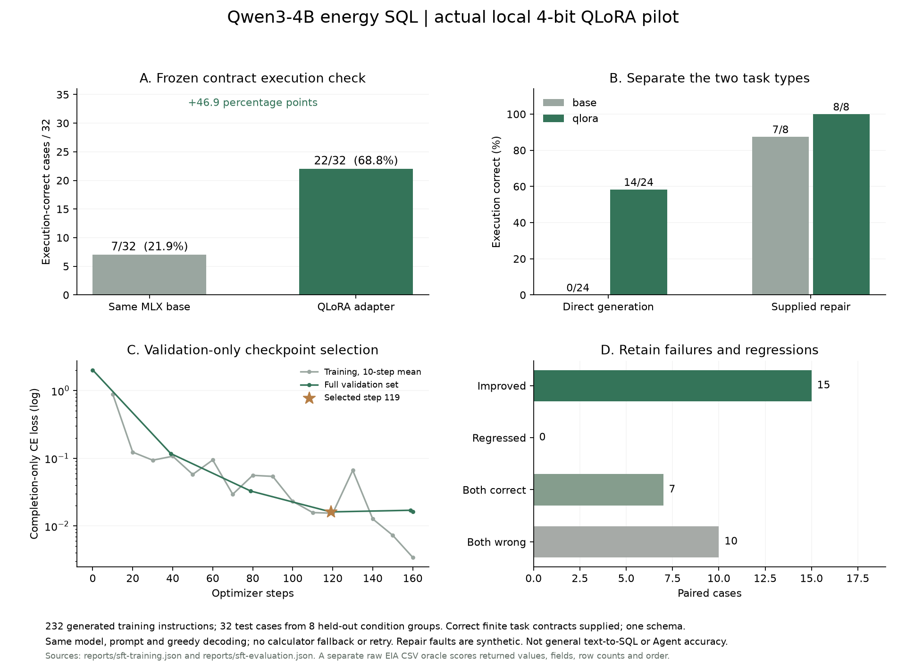
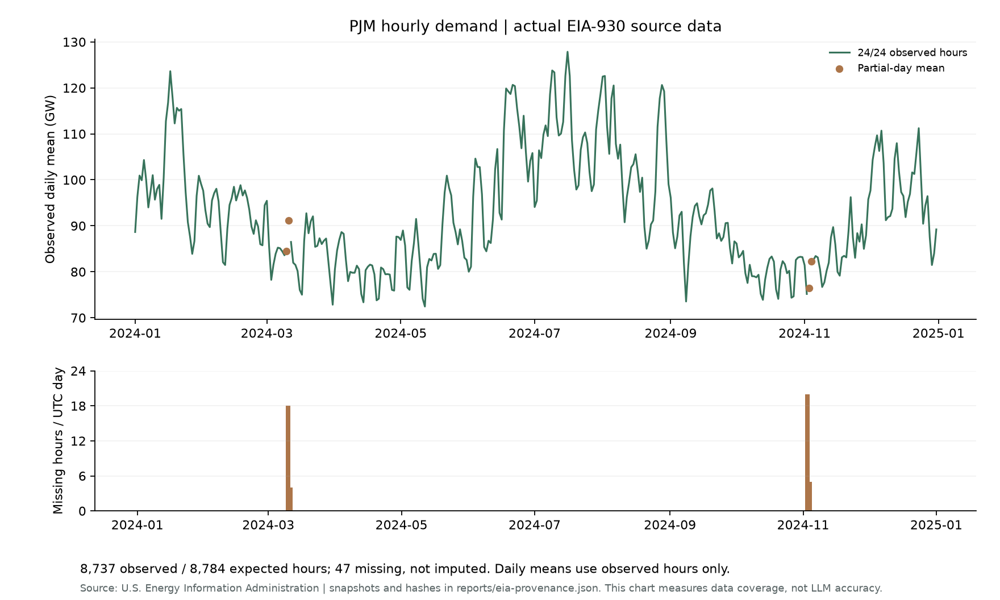
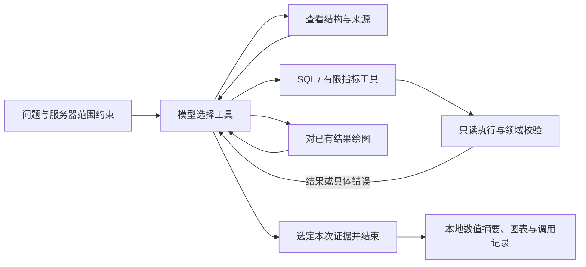
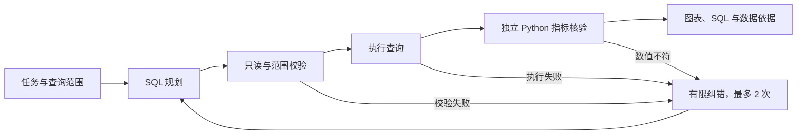
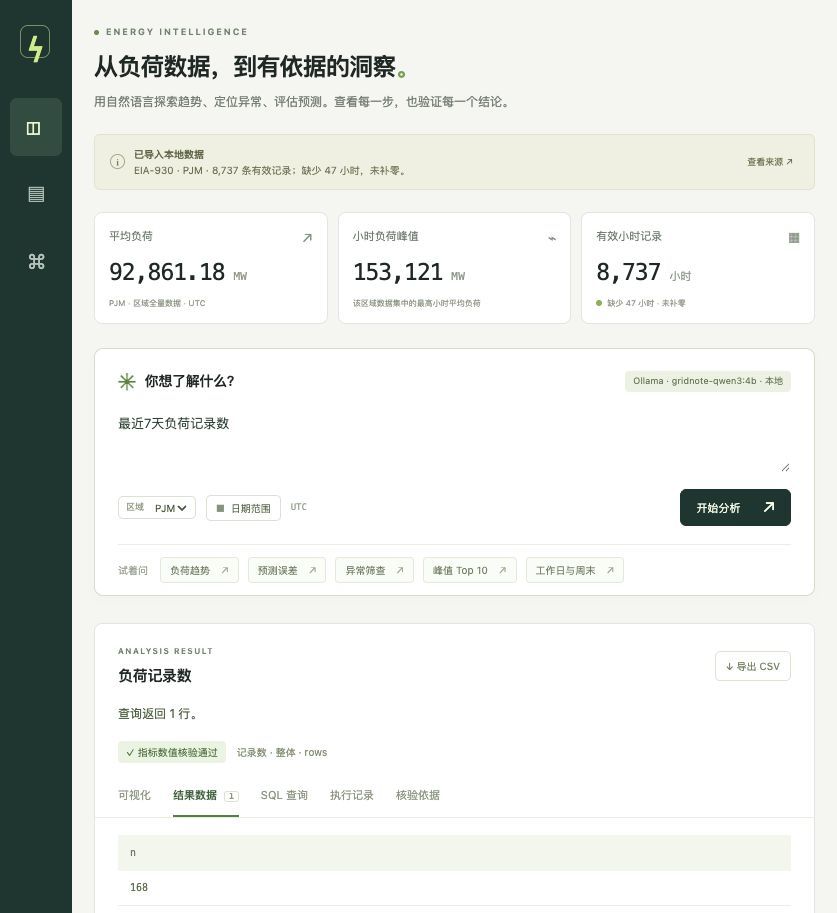
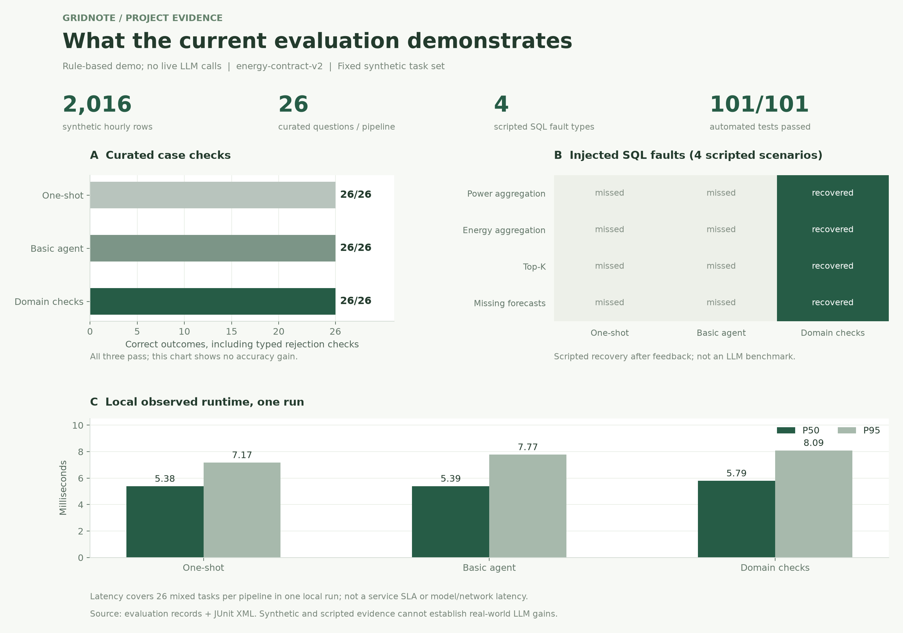
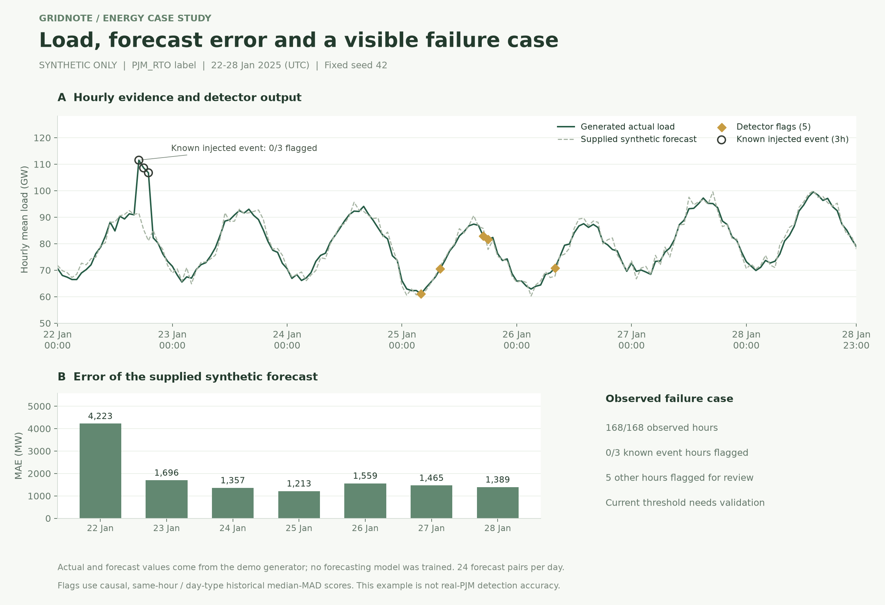

# Gridnote · Energy Data Analysis Agent

Evidence-backed energy analysis with read-only SQL, independent metric checks, and reproducible evaluations.

本地运行的能源数据分析助手。v0.3 新增 EIA-930 真实 PJM 数据、多步工具调用、工具证据展示和独立原始 CSV 契约检查。

默认仍可离线运行明确标注的合成样本；真实数据需要执行 `import-eia`。**已在 Apple Silicon 本机完成 Qwen3-4B 的 4-bit QLoRA SFT，并接入 SQL 规划流程**。在 32 道有限契约测试中，单次执行正确结果由 7 道增至 22 道。当前接入的是 EIA 发布的 PJM 历史数据；OpenAI 云端模型尚未实际调用。

微调结果与复现见 [QLoRA 实验说明](training/README.md)。原有 [Ollama 接入](docs/ollama-local.md) 仍可单独使用，其 JSON 动作配置与本次 MLX 权重训练是不同路径。

## 项目贡献与验证摘要

- 基于 LangGraph 实现规划、SQL 校验、执行、独立数值核验与有限重试，提供可追溯的图表、SQL 和数据来源。
- 补充领域检查，发现 SQL 可执行但聚合、单位、NULL 分母或 Top-K 错误的结果。
- 实现 CSV 校验及原子导入、只读与范围约束、超时预算、类型化拒答和错误结果清理。
- 接入 2024 UTC 年度 PJM 原始报告负荷，保留 **8,737 条有效小时记录**；识别并保留 **47 个缺失小时**、**1 条缺失预测记录**，不补零、不混用调整/插补列。
- 将 EIA 小时结束时间转换成 UTC 小时开始时间，读取上一年边界文件，保留 3 份原始快照 URL 与 SHA-256；8,737 条入库记录与单独读取源 CSV 的参考实现逐条一致。
- 增加 `openai-tools` 模式：模型动态选择查结构、SQL、有限指标计算、绘图和结束工具；工具结果回传模型，最终答案必须绑定本次运行的有效证据。请求数/工具数/上下文/SQL 执行均有上限，SDK 自动重试关闭。
- **36 道真实数据规则契约检查通过**（开发窗口 12、候选测试窗口 24）；同作者编写、不同时间窗口、共享任务类型，尚未独立人工复核，不能当作 LLM 准确率。
- 构建 **232 条程序生成训练指令**、24 条验证指令、32 条留出测试指令；冻结数据与提示指纹，只对输出计算损失，实际更新 **3,670,016 个参数**。相同 MLX 基座的成对对照由 **7/32 提升至 22/32（+46.9 个百分点）**，保留全部 10 个失败案例。
- 本地 **149 项自动化测试**通过，包括 OpenAI SDK 模拟 HTTP 协议、Ollama 动作协议、微调 SQL 规划接入、数据冻结、语义错误阻断、预算停止、数据快照及事务保护。
- v0.2 历史评测：在 3 个区域、28 天的 **2,016 条合成小时记录**上建立 **26 个规则评测用例**，全部通过。
- 在 **4 类主动注入的语义 SQL 故障**中验证 **4/4 检测与反馈恢复**。该诊断不代表真实 LLM 自我纠错能力；三组自然规则用例均为 26/26。

[完整评测方法](docs/evaluation.md) · [原始逐题报告](reports/evaluation.json) · [图表源数值](docs/figures/chart-values.json)

[v0.3 运行与验证说明](docs/real-agent-v0.3.md) · [真实数据来源与质量](reports/eia-provenance.json) · [真实数据逐题契约检查](reports/real-data-validation.json) · [v0.3 测试记录](reports/v0.3-test-results.xml)

最新训练证据：[训练记录](reports/sft-training.json) · [逐题成对评测](reports/sft-evaluation.json) · [失败分析](reports/sft-analysis.json) · [149 项测试记录](reports/sft-test-results.xml)。

历史 Ollama 工具联调：[联调记录，含失败尝试](reports/ollama-verification.json) · [当时 138 项测试记录](reports/ollama-test-results.xml)。两项任务分别耗时约 3.38 秒、2.04 秒，每项 2 次本地模型请求，均使用受信指标工具；它们验证工具接入，不能与下述模型 SQL 生成实验混为一组。

## 已完成的本地 QLoRA 微调

| 固定测试指标 | 同一 MLX 基座 | 基座＋选中 QLoRA |
| --- | ---: | ---: |
| SQL 结果符合有限任务契约 | 7/32（21.9%） | 22/32（68.8%） |
| SQL 执行成功 | 21/32 | 31/32 |
| 直接生成子集 | 0/24 | 14/24 |
| 错误 SQL 修复子集 | 7/8 | 8/8 |

官方 Qwen3-4B MLX 4-bit 基座，rank 8、最后 8 层、160 个训练步；只依验证损失选中第 119 步，随后固定参数运行测试。两组同提示、greedy 解码、单次请求，无自动重试或指标计算器回退；评分由独立读取 EIA CSV 的参考计算完成。

**范围：** 测试是 8 个留出任务组合下的 32 条程序生成指令；模型收到正确的有限任务合同，共享单表 schema。结果衡量该 SQL 组件，不能写成通用 Text-to-SQL 或完整 Agent 的准确率。仍有 10 个失败：7 个漏日类型过滤、2 个日类型分组错误、1 个无效 JSON。未用这些测试结果继续训练或选点。



[完整实验、复现命令与简历表述](training/README.md) · [逐题 CSV](docs/figures/sft-case-results.csv) · [图表数值与报告指纹](docs/figures/sft-chart-values.json)。应用“关于项目”从已保存的报告读取同一组证据；一次实际趋势查询通过独立数值核验。权重由本机 MLX 服务运行，尚未验证导出到 Ollama。



[SVG](docs/figures/real-pjm-overview.svg) · [每日源数值 CSV](docs/figures/real-daily-load.csv) · [图表来源指纹](docs/figures/real-chart-values.json)。部分小时缺失的日期用棕色点表示，未连入完整日均值曲线。这张图衡量真实数据与覆盖情况，不衡量模型能力。



以下为继续保留的 LangGraph 有限任务执行流程；工具 Agent 把该流程作为受限执行工具复用。



独立数值核验覆盖已定义的分析任务；超出覆盖范围的模型查询会单独标注。达到纠错上限后停止展示不可信结果。



## 快速启动

需要 Python 3.11+ 和 [uv](https://docs.astral.sh/uv/)。

```bash
uv sync --frozen
uv run energy-agent serve --port 8765
```

打开 [本地应用](http://127.0.0.1:8765)。第一次启动自动生成 `data/energy.sqlite`；已有数据库不会被启动过程覆盖。默认只监听本机。

如果依赖缓存目录不可写，可在命令前设置 `UV_CACHE_DIR="$PWD/.uv-cache"`。如果端口已占用，使用另一个 `--port`。

可直接用命令行查询和检查数据：

```bash
uv run energy-agent ask '最近7天的负荷趋势' --region PJM_RTO
uv run energy-agent ask '每日预测误差' --region DOM --start 2025-01-20 --end 2025-01-25
uv run energy-agent ask '最近7天负荷最高的10个小时' --region PJM_RTO
uv run energy-agent ask '工作日与周末负荷比较' --region DOM
uv run energy-agent ask '2025-01-01 到 2025-01-28 按周的负荷趋势' --region AECO
uv run energy-agent inspect
```

日期为 UTC，首尾日均包含。`最近7天` 以所选区域的**最新数据日**为基准，不是电脑当天。日期不提供时默认最后 7 个日历日；数据不足 7 天则取已有范围。显式请求越界会报错，不自动扩大或缩短范围。问题中的区域或日期与筛选器冲突时会报错。

## 已实现

| 能力 | 行为 |
| --- | --- |
| 分析流程 | LangGraph 显式节点、执行记录、预编译、最多 2 次查询纠错 |
| 结构化任务 | Top-K 1–100、小时/日/周/整体统计、工作日与周末分组及过滤、记录数 |
| 领域核验 | Python 独立重算已支持任务，检查聚合、单位、分母、排序、Top-K；不通过则重写或停止展示 |
| 历史异常工具 | 仅过去 28 天同小时同日类型数据，中位数/MAD，历史不足单列 |
| 可核验结果 | 实际 SQL、返回行、来源、UTC 范围、方法、截断提示、CSV 导出 |
| 数据质量 | 重复键拒绝、空预测保留、缺失小时统计、数值与整点校验、失败导入保留原库 |
| 查询约束 | AST 校验、只读连接、SQLite authorizer、所有源表引用强制套用区域与时间范围 |
| 资源约束 | 请求最多 366 天、最多展示 500 行；模型 SQL 2 秒 / 200 万 VM 指令预算、禁止递归 CTE |
| 评测 | 26 个合成用例、三组对照、类型化拒答、独立参考答案；另有 4 类显式语义故障注入诊断 |
| 模型接口 | OpenAI Responses API 的结构化计划；记录调用数、token 数和可选费用估计 |
| 本地训练组件 | MLX Qwen3-4B QLoRA SQL 计划；冻结划分、验证集选点、成对执行评测、应用证据页 |

## 演示模式与真实模型

默认 `ENERGY_PLANNER=demo` 使用规则提取任务参数并编译模板，**不调用语言模型**。支持的结构化任务会接受独立数值核验；无法识别的统计请求在规则模式下明确拒绝。配置模型后可生成开放式 SQL，但未匹配的任务会标注“语义未覆盖”，不会伪装成已验证。该解析器仍是有限规则，不是通用自然语言理解。

`demo` 是离线规则，`openai` 是原有结构化 SQL 生成，`openai-tools` 是云端工具模式，`ollama-tools` 是本地 JSON 动作模式，`mlx-sql` 是本地微调 SQL 规划器。`mlx-sql` 使用独立训练环境与选中适配器，启动方法见 [训练说明](training/README.md#使用选中的模型)。启用云端模型前，在本机编辑 `.env`（不要覆盖已有配置或把密钥提交到 Git）：

```bash
# 首次配置可参考 .env.example，填写以下变量：
# ENERGY_PLANNER=openai-tools
# OPENAI_API_KEY=你的密钥
# OPENAI_MODEL=你有权限调用且支持结构化输出的模型
# ENERGY_MAX_MODEL_CALLS=3
uv run energy-agent serve --port 8765
```

模型名必须是账号实际可用且支持所需接口的模型，示例名称不保证调用权限。修改配置后重启服务。首页固定预览不调用模型，配置存在也不等于调用已验证。`.env` 已被 Git 忽略。

数据发送范围：两种模型模式均会发送问题、范围和字段说明；`openai-tools` 还会发送模型选择工具返回的源元信息、验证状态及每次最多 20 行结果预览。完整结果最多展示 500 行，未全部发送给模型。最终数值摘要由本地代码生成，未声称模型完成自由形式分析报告。原有 `openai` 模式不发送结果行。

`openai-tools` 默认每次最多 3 次模型请求、12 次工具调用，关闭 SDK 自动重试；预算耗尽未选定证据时返回失败，不发布部分结果。原有 `openai` 模式最多 3 次查询生成，每次 SDK 最多 1 次网络重试。异常工具仍为原有探索性历史筛查，未验证真实异常准确率。

费用仅在配置 `OPENAI_INPUT_USD_PER_MILLION` 和 `OPENAI_OUTPUT_USD_PER_MILLION` 后估算；未配置表示未知，以服务商账单为准。后续真实联调入口（会调用付费 API；当前未运行）：

```bash
ENERGY_DB_PATH=data/eia-pjm.sqlite uv run energy-agent verify-model --provider openai --max-requests 3
```

该命令只检查一个任务，保存到默认忽略的 `reports/model-smoke.json`，不能用于报告准确率或改进幅度。OpenAI 云端模型对照尚未运行；本地微调组件的成对评测见前述独立报告。

本地 Ollama 不需要 OpenAI 密钥；当前机器已安装 `qwen3:4b`。可用同一份权重创建专用配置，再在 `.env` 选择：

```bash
ollama create gridnote-qwen3:4b -f models/qwen3-gridnote.Modelfile
# ENERGY_PLANNER=ollama-tools
# OLLAMA_MODEL=gridnote-qwen3:4b
# OLLAMA_BASE_URL=http://127.0.0.1:11434/v1
uv run energy-agent verify-model --provider ollama --max-requests 3
```

本地适配器仅允许回环地址，调用 Ollama 原生 `/api/chat` 的结构化输出，不发送 OpenAI 密钥、不自动切换云端。`$0` 仅指无云端 API 费用，不包含硬件与用电成本。原生多工具接口在本机的复杂提示下曾输出长文本并失败；JSON 约束、任务字段合同和专用模板组合后完成两项基础任务。所有失败都保留在验证摘要中，不能筛掉失败后报告“100% 准确率”。

## 导入真实数据

EIA 官方公开历史 CSV 无需 API 密钥，首次下载 3 个半年度文件（当前快照约 132 MB），只导入指定 UTC 年度的 PJM 原始报告值：

```bash
ENERGY_DB_PATH=data/eia-pjm.sqlite uv run energy-agent import-eia --year 2024 --download
ENERGY_DB_PATH=data/eia-pjm.sqlite uv run --group viz energy-agent validate-real --figures docs/figures
ENERGY_DB_PATH=data/eia-pjm.sqlite uv run energy-agent serve --port 8765
```

已有源文件不自动刷新；数据库已存在时，先检查再显式加 `--replace`。EIA 历史文件可能修订，复现时需要核对来源指纹。47 个缺失小时出现在源文件原始 Demand 列中，不能仅凭日期位置推断缺失原因。EIA 的报告预测快照不是本项目训练的预测结果，也不保证严格的时点回测。来源与使用说明：[EIA Open Data](https://www.eia.gov/opendata/)、[EIA Copyrights and Reuse](https://www.eia.gov/about/copyrights_reuse.php)。

CSV 必需字段为 `timestamp_utc,region,load_mw`；`forecast_mw` 可选。示例文件见 [data/example_load.csv](data/example_load.csv)。

```csv
timestamp_utc,region,load_mw,forecast_mw
2025-01-01T00:00:00Z,MY_REGION,1000,1030
2025-01-01T01:00:00Z,MY_REGION,980,
```

也接受字段别名 `datetime_beginning_utc → timestamp_utc`、`load_area → region`、`mw → load_mw`。无时区的时间按 UTC 解释，不接受本地时区的含混时间；有偏移量的时间统一换算为 UTC。每行须为整点 1 小时平均负荷，不接受未经聚合的亚小时记录。预测仍是每小时一个可选值，尚未建模预测发布时间、预测提前量及多个版本；不能据此声称完成真实预测回测。

```bash
# 默认保护已有数据库；确认要用 CSV 替换后，加 --replace。
uv run energy-agent import-csv /absolute/path/load.csv --source 'PJM 导出，文件日期及处理说明' --replace

# 或写入另一个数据库，保留当前数据：
ENERGY_DB_PATH=data/my_load.sqlite uv run energy-agent import-csv /absolute/path/load.csv --source '来源说明'
ENERGY_DB_PATH=data/my_load.sqlite uv run energy-agent serve --port 8766
```

导入先在临时数据库校验全部记录，再原子替换目标文件。重复的时间戳＋区域、非有限/负值、缺失必需字段、非整点时间、空文件都会导致失败。`forecast_mw` 留空表示未知，不能用零代替。成功导入后刷新网页。来源说明由导入者提供，应用不自动验证其真实性。

每次查询一个区域；RTO 总负荷与组成区域不能相加。应用支持显式下载 EIA 历史文件，不包含 PJM API 密钥、实时同步、预测模型训练、价格数据或生产级权限管理。

## 测试与评测

```bash
uv run pytest -q
uv run ruff check energy_agent tests training
uv run energy-agent evaluate --planner demo
# 已配置密钥时可主动运行真实模型评测（会产生 API 费用）：
uv run energy-agent evaluate --planner openai --output reports/openai-evaluation.json
```

评测在临时的合成数据库上运行，**不读取或改写业务导入数据**。26 题覆盖任务参数、周与日类型、缺失小时、空预测、零实际值、异常冷启动及类型化拒答。三组共用相同规划器、任务参数、安全约束及异常工具：

- `baseline`：单次生成，不预编译和重试。
- `agent`：预编译与 SQL 执行错误纠正。
- `domain`（默认）：在 `agent` 上增加独立 Python 数值核验，能触发语义纠错。

命令行可使用 `energy-agent ask '问题' --mode baseline|agent|domain`。自然规则用例三组均为 26/26，不能据此声称模型提升。报告另列 4 类**主动注入**的可执行错误 SQL：负荷误求和、电量误求平均、错误 Top-K、空预测补零。注入规划器仅在收到具体语义反馈后返回正确 SQL，用于验证反馈链路；不能代表真实 LLM 的自我纠错能力。该诊断中领域流程恢复 4/4，另外两组 0/4。详见 [docs/evaluation.md](docs/evaluation.md)。

`outcome` 区分 success、empty、insufficient_data、refused、rejected、failed；`error_code` 区分缺少数据、策略拒绝、输入范围、模型/配置/查询/语义失败。评测拒答必须匹配预期类型，API 报错不能计为正确拒答。输出另含可回答题正确率、类型化拒答正确率、系统失败数、P50/P95 延迟、tokens 和可选费用。

模型接口使用 HTTP Mock 验证真实 SDK 的请求格式、结构化解析、token 统计和错误脱敏；这不等于真实 API 联调。查询纠错测试通过注入实际不存在的列触发 SQLite 错误，不伪造模型评测成绩。

最新本地验证：149 项测试全部通过，Ruff 检查与 JavaScript 语法检查通过。浏览器已验证训练后模型的实际趋势查询与训练证据页，历史业务界面检查仍有记录。GitHub Actions 配置已提供；本地记录不代表远程 CI 已运行。模型权重、训练环境与数据快照保持本地忽略，不进入源码包。

## 代码结构

```text
energy_agent/
  data.py          合成样本、CSV 校验、数据覆盖统计
  eia.py           EIA-930 官方历史导入、UTC 转换、快照指纹与质量审计
  scope.py         区域、日期与冲突校验
  tasks.py         有限任务参数与指标定义的 SQL 编译
  metrics.py       独立 Python 指标核验与请求窗口覆盖统计
  anomaly.py       不含当前点或未来点的历史异常工具
  errors.py        机器可读的错误与拒答分类
  planner.py       规则模板 / OpenAI / 本地 MLX 微调 SQL 计划
  sql_sft.py       冻结的训练/推理契约提示，不含 gold SQL
  sql.py           AST 范围约束、只读执行与资源预算
  agent.py         LangGraph 工作流、纠错、结果摘要
  tool_agent.py    Responses 多步工具循环、观察反馈、证据选择及预算
  api.py           FastAPI 与本地静态界面
  evaluation.py    Python 参考答案与基线比较
  real_validation.py 单独解码原始 CSV 的契约参考实现与真实负荷图表
  fixtures/        同作者编写、按时间窗口划分的 36 题契约检查
  static/          无前端构建步骤的响应式界面
tests/             查询、数据、工作流、API 与模型契约测试
training/          QLoRA 数据构造、审计、训练、成对评测与本地服务
```

## 开源参考与本项目实现

工作流设计参考 [LangGraph 官方 SQL Agent 教程](https://docs.langchain.com/oss/python/langgraph/sql-agent)，模型接口参考 [OpenAI Structured Outputs](https://developers.openai.com/api/docs/guides/structured-outputs)。本仓库为独立实现，没有复制完整教程仓库；依赖库保留各自许可证。

v0.2 的重点是有限任务的业务数值核验、可检查的语义反馈、时间因果一致的历史工具和严格评测，未提出通用 Text-to-SQL 算法。

本项目新增的实现集中在能源数据建模、导入校验、强制查询范围、受限执行、空结果/缺失预测处理、界面与证据展示、独立数值评测和失败恢复测试。v0.3 已接入真实 EIA 数据、工具循环及本地 Qwen3；此次进一步完成有数据冻结、验证选点和同基座成对评测的 QLoRA SFT。训练框架使用官方 MLX-LM；个人贡献是业务数据与划分设计、执行审计、对照协议、失败分析及应用集成。下一阶段需要外部人工复核、更大且独立的任务集与新测试集，不声称通用算法创新。

## v0.2 历史图表与量化结果

以下保留 v0.2 的合成评测、101 项测试快照与失败分析，不能与 v0.3 初始 127 项测试、Ollama 适配后 138 项测试、微调接入后 149 项测试、36 道真实数据规则检查及 32 道微调模型测试混为一组。PNG 用于预览，SVG 用于清晰缩放，所有源数值均可导出检查。



[工程评测 SVG](docs/figures/evaluation-overview.svg) · [逐题延迟 CSV](docs/figures/latency-records.csv) · [故障诊断 CSV](docs/figures/fault-diagnostics.csv) · [全部绘图数值与来源摘要](docs/figures/chart-values.json)



[业务样例 SVG](docs/figures/energy-case-study.svg) · [小时观测及事件标记 CSV](docs/figures/energy-example.csv)

案例复核发现：当前历史异常筛查没有命中 3 个已知合成注入小时，另外标记了 5 个小时。这一图是失败分析，不能当作异常检测成功证明。26 题通过说明输出符合指定计算规则，不等于异常筛查质量已验证。详情见评测文档。

生成命令（不会调用付费模型，也不改写用户数据库）：

```bash
uv sync --frozen --group viz
uv run energy-agent evaluate --planner demo
uv run pytest -q --junitxml=reports/test-results.xml
uv run --group viz energy-agent visualize
```

可准确用于项目描述的量化表述：

> 基于 LangGraph 构建能源数据分析原型，使用覆盖 3 个区域、28 天的 2,016 条合成小时记录验证分析流程；建立 26 个评测用例和 101 项自动化测试，并在 4 类主动注入的 SQL 语义错误场景中验证检测与反馈恢复。

英文表述：

> Built a LangGraph-based energy analysis prototype validated on 2,016 synthetic hourly records across 3 regions and 28 days; created a 26-case evaluation suite and 101 automated tests, and verified detection and feedback-driven recovery in 4 scripted semantic-SQL fault scenarios.

不要把图中的单次本地规则延迟写成真实模型响应速度，或把故障注入恢复写成真实模型准确率提升。
